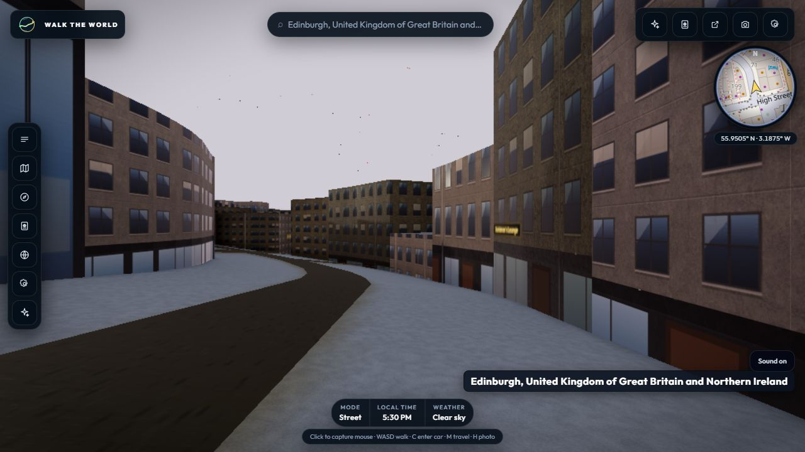

# B3 staged Edinburgh candidate renderer replay — 31 October 2026

## Input and validation

The replay used the ready 9-cell Edinburgh stage at
`.cell-refresh-staging/demo-2026-10-31T01-18-09-891Z`. Its manifest SHA-256 was
`f91d0cf97795bfd4ac72955fd3e9fcbbf08df00a55b65c47a9ec6e566d295293`.
`npm run seed:verify-refresh` passed all nine candidate hashes, completeness
checks and building-retention rules. The candidates contain nine occurrences of
tagged landuse multipolygon relations (six cemetery, three residential).

## Browser replay

`scripts/rehearse-demo.mjs` replayed those local candidate payloads through the
deployed street app at `https://walk-the-world-delta.vercel.app`. The Node-side
proxy served candidate cells locally; the run made no R2 writes.

| Measure | Result |
| --- | ---: |
| Candidate cells returned | 9/9 HTTP 200 |
| Engine ready | 6.7 s |
| Cell stream settled | 9/9 resident, 0 pending or failed |
| Console errors | 0 |
| Road-canvas paint batches | 9 |
| Landuse rings passed to paint | 29 |
| Tiles painted with landuse | 8 |
| 60-frame sample p95 | 16.9 ms, diagnostics enabled |

The frame sample is diagnostic only: performance counters were enabled, the
host is not the target i5-1035G1 laptop, and this is a one-city replay. It does
not close the full 36-cell refresh, R2 upload, or post-refresh four-city gates.
A preceding headless run failed to settle within its 45-second cell-stream
window, so it was excluded; visible Chrome settled all nine candidate cells.
This replay checks the current deployed renderer with the local snapshot, not a
local `main` build or an updated production cache.

