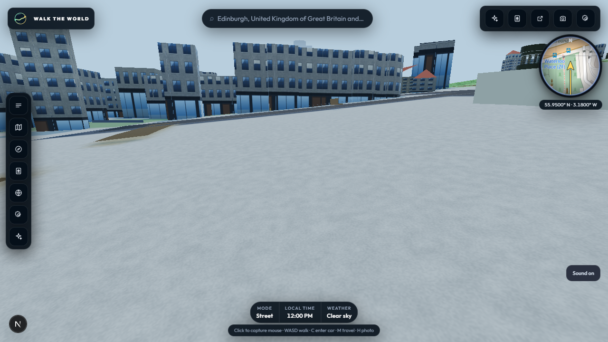

# B3 ground-overlay follow-up — 31 October 2026

Reviewed against `8ec296b` on `main`. This is a local diagnostic using a
recorded Edinburgh Overpass cell through the normal browser city API path; it
does not use or write production R2 data.

## Change

Terrain imagery loads asynchronously into the ground texture canvas, while
cell assembly paints urban land use, roads and building shadows into that same
canvas. If imagery finished after a cell was assembled, it could overwrite the
city paint. Ground paint is now collected in transparent per-cell batches and
retained per terrain tile. Late imagery re-composites the retained overlays;
terrain eviction releases the additional backing store. Assemblies also skip
allocating a paint batch when no land-use, building or road bounds overlap the
terrain tile.

The existing `city.road-canvas-paint` diagnostic now records the number of
land-use rings and the number of terrain tiles painted. This distinguishes an
empty origin cell from land-use coverage arriving with streamed neighbors.

## Browser check

A visible Chrome replay loaded the recorded Edinburgh cell on the local
development server at medium quality, noon, clear weather, starting at the
Calton cemetery area. After an 8-second walk, streamed cells reported 18
land-use rings over 12 terrain-tile paint events. The normal cemetery tint was
visible in the captured ground texture. The run reported 3.6 s engine load,
59 average FPS, 16.9 ms frame p95, and zero console, page or HTTP errors. The
renderer was the host's RTX 4060 Laptop GPU.

The screenshot and frame timing are local diagnostic evidence only. The
recorded payload is replayed for requested cells, so this does not measure live
Overpass latency, cached R2 coverage or the target i5-1035G1 laptop. B3 remains
open for the separately authorized demo-cell R2 reseed and live four-city
acceptance.

## Checks

- Focused ESLint on `terrain.js`, `assemble-city.js` and `ground-surfaces.js`:
  passed.
- Full unit suite: 238 tests passed.
- Production build: passed; the service-worker revision was refreshed by
  `prebuild`.
