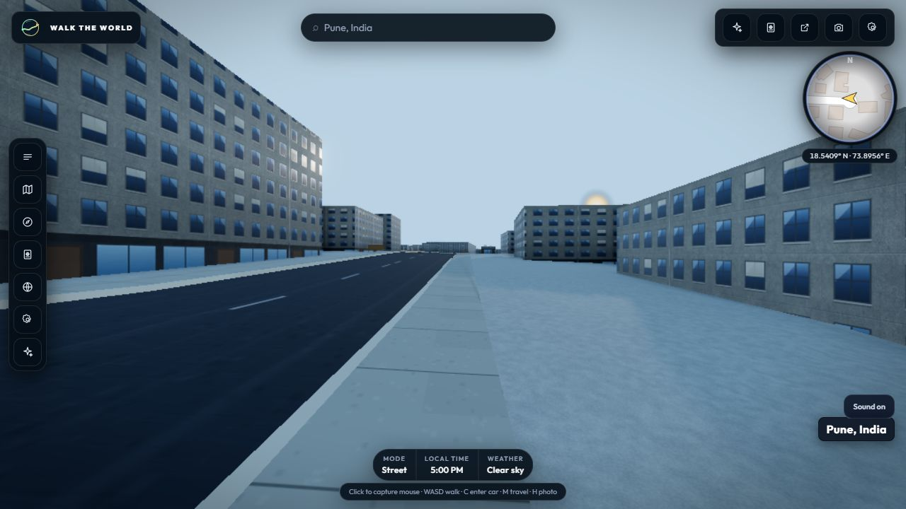
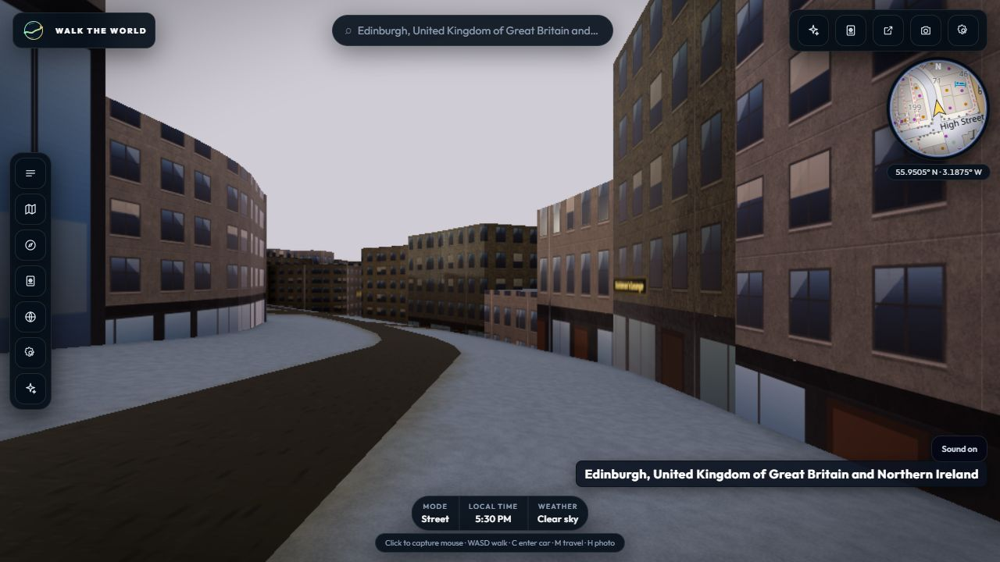
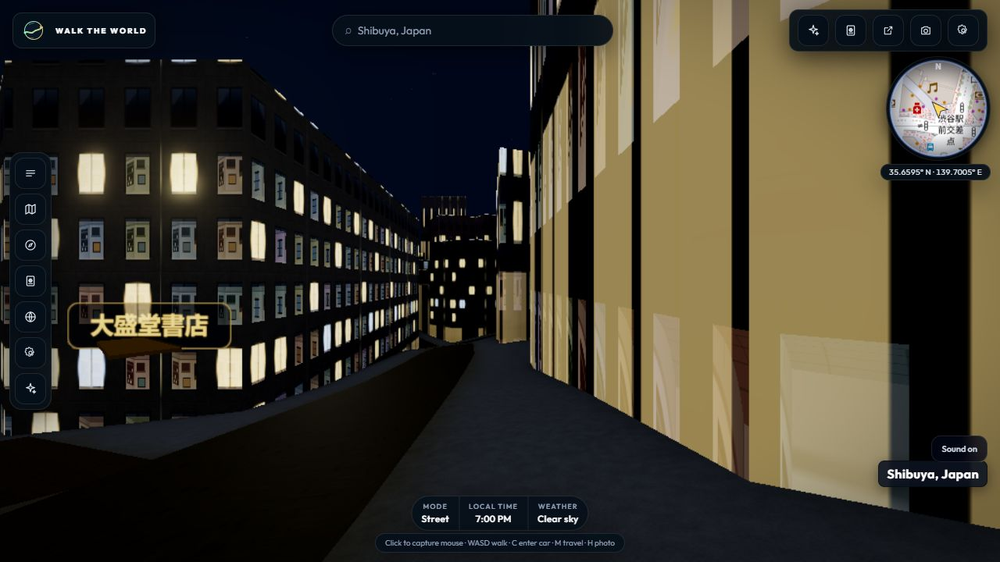
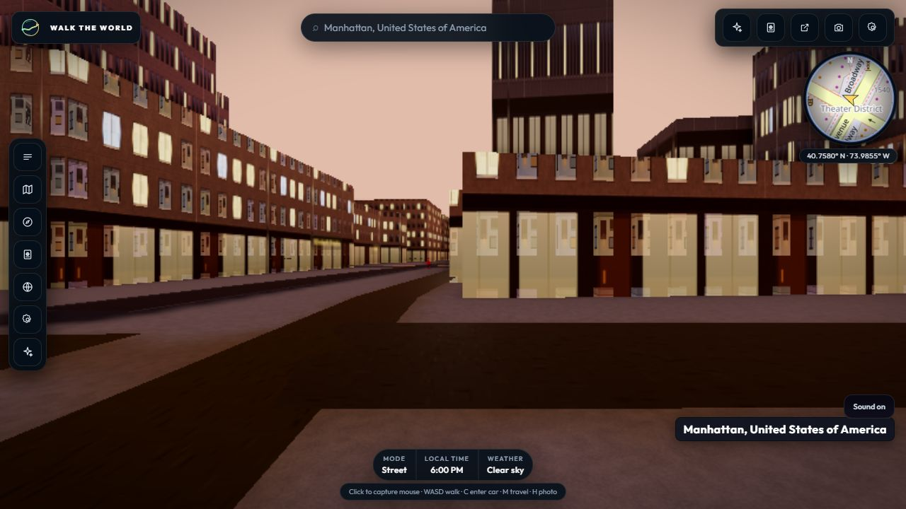

# B3 pre-refresh four-city cache baseline — 31 October 2026

## Snapshot

`rehearse-demo.mjs` read the current public cache for all four Demo places and
saved a local, read-only snapshot of the 36 requested cells. The snapshot is
54,029,531 bytes total. Per-cell byte counts and SHA-256 hashes are in
[`b3-pre-refresh-cache-cells-2026-10-31.json`](b3-pre-refresh-cache-cells-2026-10-31.json),
whose SHA-256 is
`578e63df29a0fbf46c70750b437e26ddf9ee55cacb661cbd9d8c4a7a81b9a9cf`.
No R2 writes occurred.

## Visible browser results

The deployed street app reached engine-ready, loaded all nine cells and settled
the cell stream in each city. There were zero console errors. With browser
diagnostics enabled, every city's nine road-canvas paint batches reported zero
landuse rings and zero tiles painted with urban landuse:

| City | Cells | Resident after settle | Paint batches | Landuse rings | Painted tiles | Console errors |
| --- | ---: | ---: | ---: | ---: | ---: | ---: |
| Pune | 9/9 | 9/9 | 9 | 0 | 0 | 0 |
| Edinburgh | 9/9 | 9/9 | 9 | 0 | 0 | 0 |
| Tokyo | 9/9 | 9/9 | 9 | 0 | 0 | 0 |
| New York | 9/9 | 9/9 | 9 | 0 | 0 | 0 |

This is a pre-refresh baseline for the currently cached payloads. The local
staged Edinburgh candidate replay supplies a useful comparison: it passed 29
landuse rings to paint across eight tiles. That one-city candidate result does
not establish refreshed data coverage in Pune, Tokyo or New York. All frame
timings were collected with instrumentation and are diagnostic only.

## Captures

The 36-cell refresh, separate R2 upload approval, and post-refresh four-city
visual/performance acceptance remain open.
