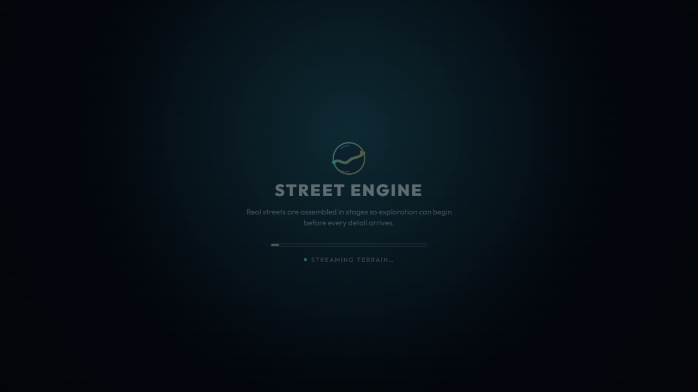

# S7 startup loader canvas visibility

Date: 31 October 2026  
Build: local production build at `4e7f5e1` plus the uncommitted visibility change  
Route: Edinburgh demo street view, 1280×720 headless Chrome

`StreetEngine` applies the initial time before starting the render loop and
before setting readiness to 100%. The loading screen therefore remains visible
during the PMREM build. The canvas used to remain visible through its
semi-transparent backdrop, so a long synchronous build could visibly freeze the
underlying scene.

The canvas container now uses `visibility: hidden` while loading and becomes
visible at input-ready. In a browser capture during the loading phase,
`getComputedStyle(.cesium-container).visibility` was `hidden`, the “STREET
ENGINE” loading card was visible, and the canvas remained mounted. A second
capture waited until the container became `visible`; the loading card was gone.
At that point `window.__engineReady` was still false because that flag waits for
city construction, which continues after input-ready.

This masks the frozen scene during boot. It does not make PMREM generation
faster or reduce time to interaction, and it is not target-laptop evidence. S7's
frame-time and terrain imagery/relief checks remain open.
