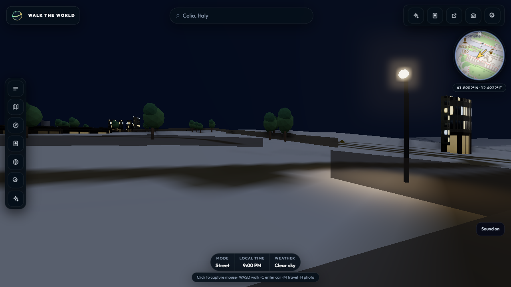
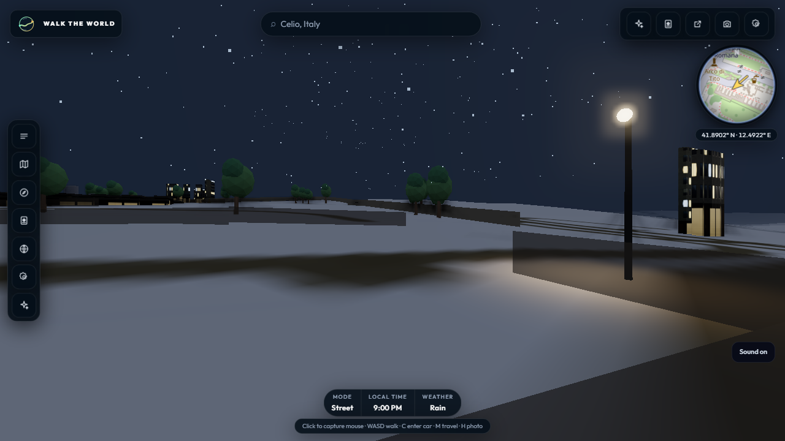

# Stage 4.3 — Current-code wet-road checkpoint

Date: 28 October 2026

Source revision: `9ca6f4d3b63b840cc170b4f4b72ad11815b9b6b2`

Status: runtime/material checks passed; visual acceptance remains open.

## Method

Built the current `main` revision and ran the production app locally with a
visible Chrome window. The benchmark replayed the checked-in Rome OSM fixture in
a fresh browser context, at night (21:00), high quality, fixed pose and seed,
with a 12-second walk per run. Clear and rain used the same view and settings.
The public R2 base from the local environment file was overridden only for the
build process so recorded fixture requests stayed local; no environment file
was changed.

Six rain runs were attempted. Rain repetition 4 recorded one aborted city-cell
request (`wtw_city6_41.885_12.498`, `net::ERR_ABORTED`) while the capture window
itself remained valid. It was excluded and repeated as rain repetition 6. Each
reported condition below therefore contains five valid, visible runs with valid
host telemetry and no browser, asset, or benchmark validation errors.

## Results

| Condition | Runs | Median FPS | Frame p95 median (range) | Frame p99 median | GPU timer p95 median | Host CPU median | GPU 3D engine median | Minimum available memory |
|---|---:|---:|---:|---:|---:|---:|---:|---:|
| Night, clear | 5 | 38 | 33.9 ms (33.6–49.9) | 50.2 ms | 21.89 ms | 57.72% | 91.86% | 1,857 MB |
| Night, rain | 5 | 40 | 33.6 ms (33.6–50.0) | 49.9 ms | 20.43 ms | 56.62% | 91.89% | 997 MB |

All runs reported the same street-light state: four pooled lights, two on and
assigned, and 17 lamp markers. The current high tier saturates the test
machine's 3D engine at roughly 92%; individual runs also showed frame-time
spikes near 50 ms and substantial host-memory pressure. These are local
measurements on one machine, not a cross-device guarantee or an A/B against the
previous revision. The rain comparison uses the same code as clear weather and
does not establish a performance change caused by wetness.

## Visual review

The matched captures show the rain sky/particles clearly, but the road-surface
reflection change is subtle from this pose. The wet-road appearance therefore
still needs a closer view beside a light pool and human visual acceptance.
Avoid adding a reflection pass until a cheaper material-only adjustment has
been evaluated against the existing frame-time budget.

## Validation and retained evidence

- `npm run test`: 16 files and 121 tests passed.
- `npm run build`: passed.
- Raw per-frame benchmark traces remain local; this report and the two captures
  retain the compact comparison and visual checkpoint.
- The recorded fixture validates the client/streaming path, not live Overpass
  availability or dense live-city behavior.
