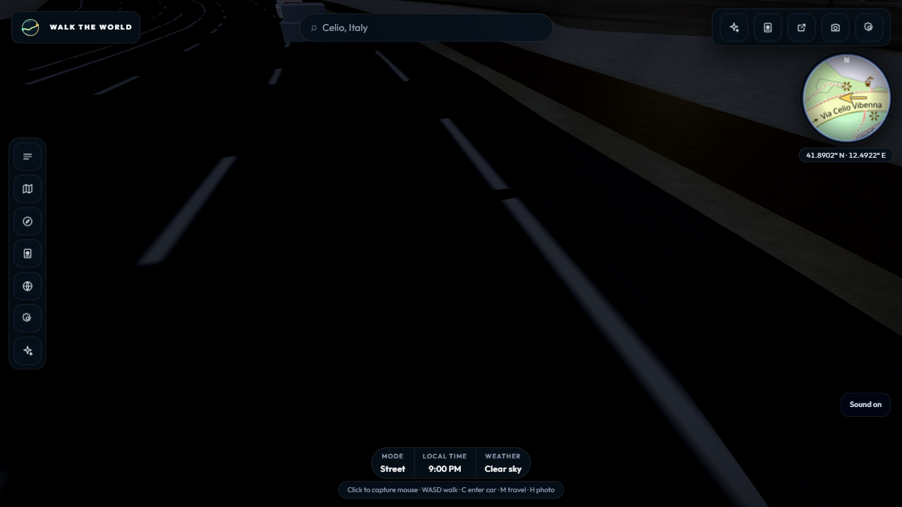
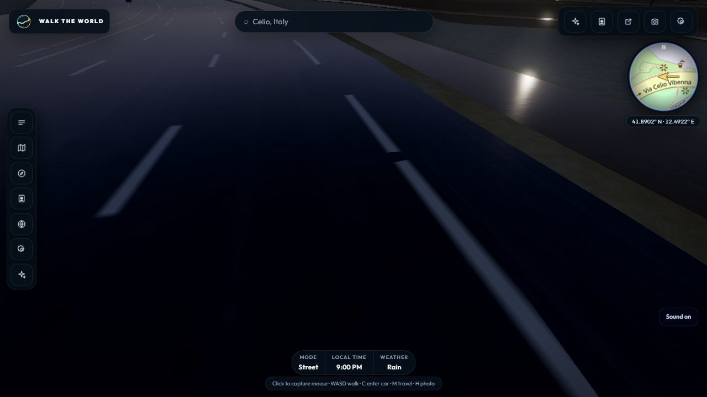

# R1 — Road-specific environment intensity check

- Date: 30 October 2026
- App revision: `8a61b80` (`sourceTreeDirty` was true because the benchmark runner had a local pitch option)
- Fixture: recorded Rome OSM showcase; no live-data or R2 writes

## Method

Built the production app and ran visible Chrome 156 on Windows 11, 1280×720 at
DPR 1, High quality, 21:00 and seed 1337. WebGL used ANGLE Direct3D 11 on
Intel UHD Graphics (`0x0000A78B`) with an Intel Core i7-13650HX host. The fixed
pose was x = −30.5 m, z = 104.8 m, heading = −1.58 rad and pitch = −0.65 rad;
each five-second walk moved about 25 m. Clear (weather 0) and rain (weather 90)
used the same fixture, pose, heading, pitch, quality, time and seed. Five valid
runs were collected per condition, alternating conditions after the first pair.

All ten measurement windows and host-telemetry windows passed validation. Each
run reported zero benchmark validation errors, failed browser requests or HTTP
errors. The benchmark's fixed-pose pitch option was added so the camera could
frame the road surface directly without changing application behavior.

## Results

| Condition | Runs | Frame p95 median (range) | GPU timer p95 median (range) | Median FPS |
| --- | ---: | ---: | ---: | ---: |
| Night, clear | 5 | 41.70 ms (41.60–41.70) | 26.67 ms (26.45–27.29) | 34 |
| Night, rain | 5 | 41.70 ms (41.60–41.80) | 27.15 ms (26.19–27.47) | 33 |

Frame p95 medians were equal. The rain GPU p95 median was 0.48 ms higher
(1.8%); the measured ranges overlap. The Intel UHD 3D engine averaged about
93% utilization during both groups, so these results describe this host and
scenario rather than a target-device performance guarantee.

A current-main WebGL audit repeated six 12:00 ↔ 21:00 environment cycles. All
seven snapshots held at 22 framebuffers and 2 renderbuffers, and the recorded
`envMapIntensity` values included the expected wet-road value 2.71. The audit
completed with no validation or HTTP errors. Counts are WebGL object counts,
not VRAM byte measurements, and do not cover engine teardown.

## Visual review

The matched close-up captures show a restrained but visible wet-road response:
rain adds a cooler sheen over the asphalt and a small lamp reflection on the
adjoining pavement, while the clear road stays matte. Retain the existing
material behavior; this check does not justify changing wet-road defaults.

Clear:

Rain:

## Reproduction

The measured run used `node scripts/bench-perf.mjs` with recorded data, High,
21:00, a five-second window, `--pose-x -30.5 --pose-z 104.8 --heading -1.58
--pose-pitch -0.65`, visible Chrome and `--renderer-mode browser-default`. Run
once per condition with `--weather 0` and `--weather 90`; the environment audit
adds `--environment-audit` to the rain run. Raw per-run JSON remains local and
ignored.
